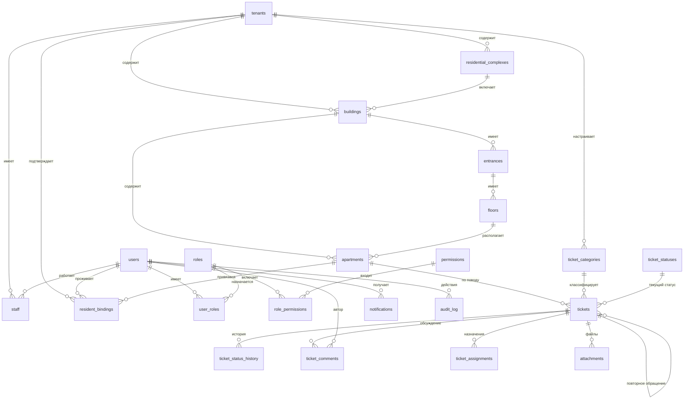

# Схема базы данных «ДомКруг» — MVP (v1)

**Версия документа:** 1.0
**Дата:** 02.11.2026
**Статус:** HISTORICAL — первоначальный проект схемы. Фактическая схема —
миграции `backend/migrations/001…023`; см. `docs/DOCS-STATUS.md`.
**СУБД:** PostgreSQL 16+
**Основание:** ТЗ v1.1 п. 6

---

## 1. Область документа

Описывает **только таблицы MVP** (v1). Сущности из п. 6 ТЗ, которые в MVP не реализуются (приборы учёта, показания, начисления, платежи, интеграции), описаны в разделе 9 как «отложенные» — с учётом их будущих связей, но **без создания таблиц** в миграциях MVP.

Принцип: **в базе нет таблиц, которые не используются.** Пустая таблица «на будущее» через полгода обрастает ошибочными предположениями.

---

## 2. Соглашения

| Решение | Значение | Обоснование |
|---|---|---|
| Тип ПК | `uuid`, `gen_random_uuid()` | Невозможно перебрать ID (нет `api/v1/tickets/1`), безопасно при переносе данных между средами и будущем шардировании |
| Расширение | `pgcrypto` | Источник `gen_random_uuid()` (в PG13+ есть и встроенная, но `pgcrypto` даёт `digest` для нужд аудита) |
| Время | `timestamptz` везде | Никаких `timestamp` без зоны. Серверы в РФ, но DST-ошибки дешевле исключить сразу |
| Имена | `snake_case`, таблицы во множественном числе | Стандарт PostgreSQL-сообщества |
| Денормализация | `tenant_id` дублируется на всех бизнес-таблицах | Позволяет проверять изоляцию **одним условием** в каждом запросе, а не джойном по 3 таблицам |
| Удаление | `deleted_at` (soft delete) для пользовательских данных; `ON DELETE RESTRICT` по умолчанию | История заявок не должна исчезать. Физическое удаление — только для служебных записей |
| Аудит | отдельная append-only таблица `audit_log` | Требование п. 6 и п. 7 ТЗ |

### 2.1. Про `tenant_id` — исключение

`users` и `roles`/`permissions` **не имеют** `tenant_id`. Причины:

- человек может быть **жителем** в одной УК и **сотрудником** другой;
- один и тот же житель может иметь квартиры в домах разных УК;
- роли — платформенный справочник, общий для всех.

Принадлежность к УК выражается через:
- `staff` — сотрудник в конкретной УК;
- `user_roles.tenant_id` — роль сотрудника в УК;
- `resident_bindings.tenant_id` — привязка жителя (выводится из дома, но хранится денормализованно).

---

## 3. Модель изоляции УК

### 3.1. Правило

**Любой запрос к бизнес-данным обязан содержать `tenant_id = :current_tenant`**, где `:current_tenant` берётся **только** из проверенного JWT-токена — никогда из тела запроса, query-параметра или заголовка, присланного клиентом.

### 3.2. Три уровня защиты

1. **Уровень приложения (обязательный).** Репозитории принимают `tenantId` первым аргументом и не имеют методов «без тенанта». Запрос без `tenant_id` физически невозможно построить через API репозитория.
2. **Уровень БД (усиление, включается в Этапе 3).** Row-Level Security: `SET LOCAL app.tenant_id = ...` в начале транзакции + политика `USING (tenant_id = current_setting('app.tenant_id')::uuid)`. Если в коде забыли условие — БД не отдаст строки.
3. **Уровень тестов.** Обязательный e2e-тест на каждую сущность: «пользователь УК-А не видит объектов УК-Б». Тест — часть определения готовности, а не «потом добавим».

### 3.3. Что считается нарушением

- Возврат объекта по ID без проверки `tenant_id`;
- поиск по глобальному уникальному полю без ограничения тенантом;
- агрегаты (COUNT, SUM) без `tenant_id`;
- экспорт/отчёты без `tenant_id`.

---

## 4. ER-диаграмма (MVP)



---

## 5. Таблицы MVP

### 5.1. Тенант и структура домов

#### `tenants` — управляющие компании

| Поле | Тип | Обяз. | Описание |
|---|---|---|---|
| `id` | uuid PK | да | `gen_random_uuid()` |
| `name` | text | да | Полное название УК |
| `slug` | text UNIQUE | да | Короткий идентификатор (для поддомена/ссылки) |
| `inn` | text | нет | ИНН, 10 или 12 цифр |
| `contact_email` | citext | нет | |
| `contact_phone` | text | нет | |
| `status` | text | да | `active` / `suspended` / `archived`, default `active` |
| `created_at` | timestamptz | да | default `now()` |
| `updated_at` | timestamptz | да | триггер |
| `deleted_at` | timestamptz | нет | soft delete |

**Индексы:** `UNIQUE(slug)`, `UNIQUE(inn) WHERE inn IS NOT NULL`, `INDEX(status) WHERE deleted_at IS NULL`.

**Удаление:** `RESTRICT` — УК с данными не удаляется, только `archived`. Физическое удаление запрещено.

---

#### `residential_complexes` — жилые комплексы

| Поле | Тип | Обяз. | Описание |
|---|---|---|---|
| `id` | uuid PK | да | |
| `tenant_id` | uuid FK → tenants | да | `ON DELETE RESTRICT` |
| `name` | text | да | Название ЖК |
| `address_text` | text | нет | Общий адрес/описание расположения |
| `status` | text | да | `active` / `archived` |
| `created_at`, `updated_at` | timestamptz | да | |
| `deleted_at` | timestamptz | нет | |

**Индексы:** `UNIQUE(tenant_id, name) WHERE deleted_at IS NULL`, `INDEX(tenant_id, status)`.

**Удаление:** `RESTRICT` при наличии домов. Только `archived` при наличии данных.

---

#### `buildings` — объекты управления

| Поле | Тип | Обяз. | Описание |
|---|---|---|---|
| `id` | uuid PK | да | |
| `tenant_id` | uuid FK | да | |
| `complex_id` | uuid FK → residential_complexes | **нет** | Объект может быть без ЖК |
| `object_kind` | text | да | `apartment_building`, `cottage_settlement`, `mixed_use`, `commercial_building` |
| `city` | text | да | |
| `street` | text | да | |
| `house_number` | text | да | Может быть «12А» — потому text |
| `building_number` | text | нет | Корпус/строение |
| `postal_code` | text | нет | |
| `address_text` | text | да | Полный адрес одной строкой (для отображения и поиска) |
| `total_entrances` | int | нет | Для валидации, если подъезды не заведены |
| `total_floors` | int | нет | |
| `year_built` | int | нет | |
| `created_at`, `updated_at` | timestamptz | да | |
| `deleted_at` | timestamptz | нет | |

**Индексы:** `INDEX(tenant_id, complex_id)`, `INDEX(tenant_id, city, street)`, `INDEX(tenant_id, address_text)` — GIN/trgm для поиска по адресу (добавляется, если поиск станет медленным; на MVP — обычный btree).

**Уникальность адреса:** `UNIQUE(tenant_id, city, street, house_number, COALESCE(building_number,'')) WHERE deleted_at IS NULL` — избегаем дублей домов внутри одной УК.

**Удаление:** `RESTRICT` при наличии квартир/заявок. `deleted_at` — только если заведён ошибочно и нет связей.

---

#### `building_passports` — паспорт объекта

| Поле | Тип | Обяз. | Описание |
|---|---|---|---|
| `id` | uuid PK | да | |
| `tenant_id` | uuid FK | да | |
| `building_id` | uuid FK → buildings | да | `UNIQUE`, `ON DELETE CASCADE` |
| `cadastral_number` | text | нет | |
| `year_commissioned` | int | нет | 1700–2100 |
| `total_area`, `living_area`, `commercial_area`, `land_area` | numeric(12,2) | нет | м², ≥ 0 |
| `parking_spots` | int | нет | машиноместа |
| `elevators_count` | int | нет | |
| `energy_class` | text | нет | A+…G |
| `management_start`, `warranty_until` | date | нет | |
| `notes` | text | нет | |
| `created_at`, `updated_at` | timestamptz | да | |

**Индексы:** `UNIQUE(building_id)`, `UNIQUE(tenant_id, building_id)`, `INDEX(tenant_id)`.

**Правило:** год постройки, этажность и число подъездов остаются в
`buildings`; паспорт не дублирует их, чтобы не было двух источников истины.

---

#### `entrances` — подъезды

| Поле | Тип | Обяз. | Описание |
|---|---|---|---|
| `id` | uuid PK | да | |
| `tenant_id` | uuid FK | да | |
| `building_id` | uuid FK → buildings | да | `ON DELETE RESTRICT` |
| `number` | int | да | Номер подъезда |
| `created_at`, `updated_at` | timestamptz | да | |

**Индексы:** `UNIQUE(building_id, number)`.

**Удаление:** `RESTRICT` при наличии этажей/квартир.

---

#### `floors` — этажи

| Поле | Тип | Обяз. | Описание |
|---|---|---|---|
| `id` | uuid PK | да | |
| `tenant_id` | uuid FK | да | |
| `entrance_id` | uuid FK → entrances | да | |
| `number` | int | да | Может быть отрицательным (подземный) |
| `created_at`, `updated_at` | timestamptz | да | |

**Индексы:** `UNIQUE(entrance_id, number)`.

**Замечание:** этажи — самая «спорная» сущность из ТЗ. На практике для заявок важен номер квартиры, а не этаж. Таблица оставлена потому, что ТЗ её требует и она может понадобиться для обхода/осмотра. Если на пилоте не будет использоваться — кандидат на удаление в v2.

**Удаление:** `RESTRICT`.

---

#### `apartments` — квартиры и помещения

| Поле | Тип | Обяз. | Описание |
|---|---|---|---|
| `id` | uuid PK | да | |
| `tenant_id` | uuid FK | да | |
| `building_id` | uuid FK | да | |
| `entrance_id` | uuid FK → entrances | нет | Может быть не указан при импорте |
| `floor_id` | uuid FK → floors | нет | |
| `number` | text | да | «42», «42А» — text, не int |
| `kind` | text | да | `apartment` / `nonresidential`, default `apartment` |
| `rooms` | int | нет | |
| `area_total` | numeric(10,2) | нет | м² |
| `status` | text | да | `active` / `archived` |
| `created_at`, `updated_at` | timestamptz | да | |
| `deleted_at` | timestamptz | нет | |

**Индексы:** `UNIQUE(building_id, number) WHERE deleted_at IS NULL`, `INDEX(tenant_id, building_id)`, `INDEX(tenant_id, entrance_id)`.

**Удаление:** `RESTRICT` при наличии заявок или привязок жителей (иначе потеряется история). Только `archived`.

---

#### `owners` — физические лица-собственники

| Поле | Тип | Обяз. | Описание |
|---|---|---|---|
| `id` | uuid PK | да | |
| `tenant_id` | uuid FK | да | |
| `full_name` | text | да | 2–200 символов |
| `phone`, `email` | text | нет | Контакты |
| `notes` | text | нет | |
| `created_at`, `updated_at` | timestamptz | да | |
| `deleted_at` | timestamptz | нет | Архив |

**Важно:** это не учётная запись. Связь с приложением — отдельная
`resident_bindings`.

---

#### `ownerships` — права собственника на помещение

| Поле | Тип | Обяз. | Описание |
|---|---|---|---|
| `id` | uuid PK | да | |
| `tenant_id` | uuid FK | да | |
| `apartment_id` | uuid FK → apartments | да | `RESTRICT` |
| `owner_id` | uuid FK → owners | да | `RESTRICT` |
| `role` | text | да | `owner` / `representative` |
| `share_percent` | numeric(5,2) | да | 0,01–100 |
| `valid_from` | date | да | |
| `valid_to` | date | нет | NULL — бессрочно |
| `created_by` | uuid FK → users | нет | Кто завёл |
| `created_at`, `updated_at` | timestamptz | да | |
| `deleted_at` | timestamptz | нет | Архив |

**Индексы:** `UNIQUE(apartment_id, owner_id) WHERE deleted_at IS NULL`,
`INDEX(tenant_id, apartment_id)`, `INDEX(tenant_id, owner_id)`.

**Правило:** запись архивируется, а не удаляется физически; при отсутствии
других активных прав карточка `owners` тоже архивируется.

---

### 5.2. Пользователи, роли, сотрудники

#### `users` — пользователи платформы

| Поле | Тип | Обяз. | Описание |
|---|---|---|---|
| `id` | uuid PK | да | |
| `email` | citext | нет | UNIQUE, если задан |
| `phone` | text | нет | UNIQUE, если задан. Нормализуется до `+7XXXXXXXXXX` |
| `password_hash` | text | да | Argon2id |
| `full_name` | text | да | |
| `status` | text | да | `active` / `blocked` / `deleted`, default `active` |
| `email_verified_at` | timestamptz | нет | |
| `phone_verified_at` | timestamptz | нет | |
| `last_login_at` | timestamptz | нет | |
| `created_at`, `updated_at` | timestamptz | да | |
| `deleted_at` | timestamptz | нет | |

**Ограничение:** `CHECK (email IS NOT NULL OR phone IS NOT NULL)` — должен быть хотя бы один идентификатор.

**Индексы:** `UNIQUE(email) WHERE email IS NOT NULL AND deleted_at IS NULL`, `UNIQUE(phone) WHERE phone IS NOT NULL AND deleted_at IS NULL`.

**Удаление:** soft delete. Блокировка (`blocked`) — штатный способ отключить доступ; удаление — по запросу субъекта ПДн (152-ФЗ), с анонимизацией ФИО/телефона и сохранением истории заявок.

---

#### `roles` — роли (справочник)

| Поле | Тип | Обяз. | Описание |
|---|---|---|---|
| `id` | uuid PK | да | |
| `code` | text UNIQUE | да | Машиночитаемый код |
| `name` | text | да | Отображаемое имя |
| `is_system` | boolean | да | true — нельзя удалить/переименовать, default false |
| `created_at` | timestamptz | да | |

**Начальные значения:**

| code | name | Область |
|---|---|---|
| `platform_admin` | Системный администратор платформы | Глобальная |
| `uk_admin` | Администратор УК | В рамках УК |
| `uk_manager` | Руководитель УК | В рамках УК (v2) |
| `dispatcher` | Диспетчер УК | В рамках УК |
| `executor` | Исполнитель / технический специалист | В рамках УК |
| `resident` | Житель | Глобальная (действует по привязкам) |

**Удаление:** `RESTRICT`, `is_system = true` не удаляются.

---

#### `permissions` — права доступа (справочник)

| Поле | Тип | Обяз. | Описание |
|---|---|---|---|
| `id` | uuid PK | да | |
| `code` | text UNIQUE | да | Вида `ticket.create`, `ticket.assign` |
| `description` | text | да | |
| `created_at` | timestamptz | да | |

**Соглашение по коду:** `<сущность>.<действие>`. Сущность в единственном числе. Примеры: `ticket.create`, `ticket.assign`, `ticket.close`, `building.update`, `resident.confirm`, `user.manage`.

**Удаление:** `RESTRICT`.

---

#### `role_permissions` — связь роль ↔ право

| Поле | Тип | Обяз. |
|---|---|---|
| `role_id` | uuid FK → roles | да |
| `permission_id` | uuid FK → permissions | да |

**ПК:** `(role_id, permission_id)` (составной). **Индекс:** обратный `(permission_id)` для проверки «кто имеет право».

**Удаление:** `CASCADE` от роли/права — это служебная связь, не пользовательские данные.

---

#### `user_roles` — назначенные роли

| Поле | Тип | Обяз. | Описание |
|---|---|---|---|
| `id` | uuid PK | да | |
| `user_id` | uuid FK → users | да | |
| `role_id` | uuid FK → roles | да | |
| `tenant_id` | uuid FK → tenants | **нет** | NULL = глобальная роль (`platform_admin`, `resident`) |
| `granted_by` | uuid FK → users | нет | |
| `created_at` | timestamptz | да | |

**Индексы:** `UNIQUE(user_id, role_id, tenant_id)`, `INDEX(tenant_id, role_id)`.

**Правило:** для `dispatcher`, `executor`, `uk_admin`, `uk_manager` поле `tenant_id` **обязательно** (проверяется в приложении и `CHECK`-триггером).

**Удаление:** `RESTRICT` для пользователя, `CASCADE` для роли.

---

#### `staff` — сотрудники УК (трудовые записи)

| Поле | Тип | Обяз. | Описание |
|---|---|---|---|
| `id` | uuid PK | да | |
| `tenant_id` | uuid FK | да | |
| `user_id` | uuid FK → users | да | |
| `position` | text | нет | Должность текстом («Сантехник») |
| `is_active` | boolean | да | default true |
| `hired_at` | date | нет | |
| `fired_at` | date | нет | |
| `created_at`, `updated_at` | timestamptz | да | |

**Индексы:** `UNIQUE(tenant_id, user_id)`, `INDEX(tenant_id, is_active)`.

**Зачем отдельно от `user_roles`:** роль — это право, сотрудник — это факт трудовых отношений. Сантехник может быть деактивирован (уволен), а история его заявок должна остаться. Плюс нужна должность для отчётов.

**Удаление:** `RESTRICT` — уволенный сотрудник `is_active = false`, не удаляется.

---

#### `resident_bindings` — привязка жителя к квартире

| Поле | Тип | Обяз. | Описание |
|---|---|---|---|
| `id` | uuid PK | да | |
| `tenant_id` | uuid FK | да | Денормализация для изоляции |
| `user_id` | uuid FK → users | да | |
| `apartment_id` | uuid FK → apartments | да | |
| `role_in_apartment` | text | да | `owner` / `renter` (арендатор) / `representative`, default `owner` |
| `status` | text | да | `pending` / `confirmed` / `rejected`, default `pending` |
| `reject_reason` | text | нет | Обязателен при `rejected` |
| `requested_at` | timestamptz | да | default `now()` |
| `confirmed_by` | uuid FK → users | нет | Сотрудник УК |
| `confirmed_at` | timestamptz | нет | |
| `created_at`, `updated_at` | timestamptz | да | |

**Индексы:** `UNIQUE(user_id, apartment_id)`, `INDEX(tenant_id, status)`, `INDEX(apartment_id)`, `INDEX(user_id)`.

**Правила:**
- `CHECK (status <> 'rejected' OR reject_reason IS NOT NULL)`;
- `CHECK (status <> 'confirmed' OR confirmed_by IS NOT NULL)`;
- создание заявки требует **хотя бы одной** записи `confirmed` на эту квартиру.

**Удаление:** `RESTRICT` от пользователя; `CASCADE` от квартиры **запрещён** — при удалении квартиры сначала архивируются привязки.

---

### 5.3. Заявки

#### `ticket_categories` — категории заявок

| Поле | Тип | Обяз. | Описание |
|---|---|---|---|
| `id` | uuid PK | да | |
| `tenant_id` | uuid FK | **нет** | NULL = системная категория по умолчанию |
| `code` | text | да | `plumbing`, `electrical`, ... |
| `name` | text | да | «Сантехника» |
| `default_sla_hours` | int | да | Срок исполнения по умолчанию, default 24 |
| `is_emergency` | boolean | да | Аварийная категория, default false |
| `sort_order` | int | да | default 100 |
| `is_active` | boolean | да | default true |
| `created_at`, `updated_at` | timestamptz | да | |

**Индексы:** `UNIQUE(tenant_id, code) WHERE tenant_id IS NOT NULL`, `UNIQUE(code) WHERE tenant_id IS NULL`, `INDEX(tenant_id, is_active, sort_order)`.

**Начальный набор (системные, `tenant_id = NULL`):** 12 категорий из ТЗ п. 4.2.
**Аварийные:** лифтовое оборудование, электроснабжение, отопление (SLA — минуты), помечаются `is_emergency = true`.

**Удаление:** `RESTRICT` при наличии заявок; деактивация — `is_active = false`.

---

#### `ticket_statuses` — статусы заявок (справочник)

| Поле | Тип | Обяз. | Описание |
|---|---|---|---|
| `id` | uuid PK | да | |
| `code` | text UNIQUE | да | |
| `name` | text | да | |
| `sort_order` | int | да | |
| `is_terminal` | boolean | да | Закрыта/Отклонена |
| `created_at` | timestamptz | да | |

**Начальные значения:**

| code | name | sort | terminal |
|---|---|---|---|
| `new` | Новая | 10 | — |
| `accepted` | Принята | 20 | — |
| `assigned` | Назначен исполнитель | 30 | — |
| `in_progress` | В работе | 40 | — |
| `waiting` | Ожидает материалов или доступа | 50 | — |
| `done` | Выполнена | 60 | — |
| `closed` | Закрыта | 70 | да |
| `rejected` | Отклонена | 80 | да |

**Важно:** статус `done` в MVP **не используется** в основном потоке (решение C — исполнитель закрывает сразу). Оставлен в справочнике, потому что: (а) ТЗ его требует, (б) может понадобиться, если УК захочет промежуточную проверку. Переход `in_progress|waiting → closed` разрешён, `→ done` — тоже.

**Удаление:** `RESTRICT`, справочник не редактируется.

---

#### `tickets` — заявки (ядро)

| Поле | Тип | Обяз. | Описание |
|---|---|---|---|
| `id` | uuid PK | да | |
| `tenant_id` | uuid FK | да | |
| `number` | int | да | Сквозной номер **внутри УК** |
| `building_id` | uuid FK → buildings | да | |
| `apartment_id` | uuid FK → apartments | **нет** | Заявка может быть по МОП (местам общего пользования) |
| `category_id` | uuid FK → ticket_categories | да | |
| `status_id` | uuid FK → ticket_statuses | да | default `new` |
| `priority` | text | да | `low` / `normal` / `high` / `emergency`, default `normal` |
| `source` | text | да | `resident_app` / `dispatcher_phone` / `dispatcher_walkin` |
| `title` | text | нет | Краткая тема (1 строка) |
| `description` | text | да | Описание проблемы |
| `contact_phone` | text | да | Телефон для связи |
| `contact_name` | text | нет | Если заявка не от жителя |
| `location_note` | text | нет | Уточнение места: «подъезд 3, этаж 5, у лифта». Нужно для заявок по МОП |
| `created_by` | uuid FK → users | да | Житель или сотрудник |
| `assigned_to` | uuid FK → users | нет | Текущий исполнитель |
| `parent_ticket_id` | uuid FK → tickets | нет | Ссылка на исходную (повторное обращение) |
| `sla_due_at` | timestamptz | нет | Рассчитывается при создании |
| `accepted_at` | timestamptz | нет | |
| `started_at` | timestamptz | нет | |
| `closed_at` | timestamptz | нет | |
| `closed_by` | uuid FK → users | нет | |
| `resolution_note` | text | **условно** | Обязателен при `closed` |
| `created_at`, `updated_at` | timestamptz | да | |
| `deleted_at` | timestamptz | нет | |

**Индексы:**

| Индекс | Зачем |
|---|---|
| `UNIQUE(tenant_id, number)` | Номер в рамках УК |
| `INDEX(tenant_id, status_id, created_at DESC)` | Инбокс диспетчера — главный экран |
| `INDEX(tenant_id, assigned_to, status_id)` | «Мои заявки» исполнителя |
| `INDEX(tenant_id, building_id, created_at DESC)` | История по дому |
| `INDEX(tenant_id, apartment_id, created_at DESC)` | История по квартире |
| `INDEX(tenant_id, sla_due_at) WHERE closed_at IS NULL` | Просрочки (частичный индекс — маленький и быстрый) |
| `INDEX(tenant_id, parent_ticket_id) WHERE parent_ticket_id IS NOT NULL` | Повторные обращения |
| `INDEX(tenant_id, created_at DESC)` | Общие списки |

**Ограничения:**

- `CHECK (priority IN ('low','normal','high','emergency'))`;
- `CHECK (source IN ('resident_app','dispatcher_phone','dispatcher_walkin'))`;
- `CHECK (status не terminal OR closed_at IS NOT NULL)` — триггер, не CHECK (нужен join);
- `CHECK (status = 'closed' → resolution_note IS NOT NULL)` — триггер;
- `CHECK (parent_ticket_id <> id)`.

**Генерация `number`:** последовательность на тенант — `ticket_numbers(tenant_id PK, last_number int)`, инкремент в той же транзакции через `UPDATE ... RETURNING`. Альтернатива — `MAX(number)+1` под блокировкой, но последовательность честнее и без гонок.

**Удаление:** soft delete (`deleted_at`) только админом УК; «удалённые» скрыты из списков, но остаются в БД для аудита. Физическое удаление запрещено.

---

#### `ticket_status_history` — история статусов (append-only)

| Поле | Тип | Обяз. | Описание |
|---|---|---|---|
| `id` | uuid PK | да | |
| `tenant_id` | uuid FK | да | |
| `ticket_id` | uuid FK → tickets | да | |
| `from_status_id` | uuid FK → ticket_statuses | **нет** | NULL при создании |
| `to_status_id` | uuid FK → ticket_statuses | да | |
| `changed_by` | uuid FK → users | да | |
| `comment` | text | нет | Пояснение перехода |
| `created_at` | timestamptz | да | |

**Индексы:** `INDEX(ticket_id, created_at ASC)`, `INDEX(tenant_id, created_at DESC)`.

**Правила:** только INSERT. UPDATE/DELETE запрещены (триггер + отсутствие прав приложения). Первая запись создаётся автоматически при создании заявки (`NULL → new`).

**Удаление:** запрещено.

---

#### `ticket_assignments` — назначения исполнителей (история)

| Поле | Тип | Обяз. | Описание |
|---|---|---|---|
| `id` | uuid PK | да | |
| `tenant_id` | uuid FK | да | |
| `ticket_id` | uuid FK → tickets | да | |
| `assignee_id` | uuid FK → users | да | |
| `assigned_by` | uuid FK → users | да | |
| `assigned_at` | timestamptz | да | default `now()` |
| `unassigned_at` | timestamptz | нет | Когда сняли/переназначили |
| `note` | text | нет | |

**Индексы:** `INDEX(ticket_id, assigned_at DESC)`, `INDEX(tenant_id, assignee_id, assigned_at DESC)`.

**Зачем отдельно от `tickets.assigned_to`:** нужна история — «кто держал заявку и когда». `tickets.assigned_to` — денормализация для быстрых запросов.

**Удаление:** запрещено (история).

---

#### `ticket_comments` — комментарии к заявке

| Поле | Тип | Обяз. | Описание |
|---|---|---|---|
| `id` | uuid PK | да | |
| `tenant_id` | uuid FK | да | |
| `ticket_id` | uuid FK → tickets | да | |
| `author_id` | uuid FK → users | да | |
| `body` | text | да | |
| `is_internal` | boolean | да | true — служебный, житель не видит, default false |
| `created_at`, `updated_at` | timestamptz | да | |
| `deleted_at` | timestamptz | нет | |

**Индексы:** `INDEX(ticket_id, created_at ASC)`, `INDEX(tenant_id, author_id)`.

**Правила:** житель видит только `is_internal = false`. Автор может редактировать своё в течение 15 минут (иначе — только удаление админом).

**Удаление:** soft delete (автор или админ УК), текст сохраняется для аудита.

---

#### `attachments` — фотографии и документы

| Поле | Тип | Обяз. | Описание |
|---|---|---|---|
| `id` | uuid PK | да | |
| `tenant_id` | uuid FK | да | |
| `ticket_id` | uuid FK → tickets | да | |
| `comment_id` | uuid FK → ticket_comments | нет | Если файл приложен к комментарию |
| `kind` | text | да | `request_photo` / `result_photo` / `comment_file` / `document` |
| `storage_key` | text UNIQUE | да | Путь в S3, НЕ публичный URL |
| `original_name` | text | да | Исходное имя файла |
| `mime_type` | text | да | Проверяется по белому списку |
| `size_bytes` | bigint | да | Лимит на приложении (10 МБ фото, 20 МБ документ) |
| `uploaded_by` | uuid FK → users | да | |
| `created_at` | timestamptz | да | |
| `deleted_at` | timestamptz | нет | |

**Индексы:** `INDEX(ticket_id, created_at)`, `INDEX(tenant_id, kind)`.

**Правила:**
- физические файлы — **только в S3**, не в БД и не на диске сервера;
- `storage_key` не отдаётся клиенту; доступ — через подписанный URL с TTL 5 минут;
- `mime_type` из белого списка: `image/jpeg`, `image/png`, `image/webp`, `video/mp4`, `application/pdf`;
- проверка «файл принадлежит заявке этой УК» перед выдачей URL.

**Удаление:** soft delete; физический файл удаляется фоновой задачей через 30 дней.

---

### 5.4. Уведомления, новости, аудит

#### `notifications` — уведомления (внутрисистемные)

| Поле | Тип | Обяз. | Описание |
|---|---|---|---|
| `id` | uuid PK | да | |
| `tenant_id` | uuid FK | нет | NULL для платформенных |
| `user_id` | uuid FK → users | да | Получатель |
| `type` | text | да | `ticket_created` / `ticket_status_changed` / `ticket_assigned` / `resident_binding_confirmed` / `news_published` |
| `title` | text | да | |
| `body` | text | нет | |
| `entity_type` | text | нет | `ticket` / `news` / `resident_binding` |
| `entity_id` | uuid | нет | |
| `read_at` | timestamptz | нет | NULL = непрочитано |
| `created_at` | timestamptz | да | |

**Индексы:** `INDEX(user_id, read_at) WHERE read_at IS NULL` (счётчик непрочитанных), `INDEX(user_id, created_at DESC)`.

**Удаление:** `CASCADE` от пользователя (его личные уведомления), физическое удаление старше 90 дней — фоновая задача.

---

#### `news` — объявления и новости

| Поле | Тип | Обяз. | Описание |
|---|---|---|---|
| `id` | uuid PK | да | |
| `tenant_id` | uuid FK | да | |
| `scope` | text | да | `tenant` / `complex` / `building` |
| `complex_id` | uuid FK → residential_complexes | условно | Обязателен при `scope = complex` |
| `building_id` | uuid FK → buildings | условно | Обязателен при `scope = building` |
| `title` | text | да | |
| `body` | text | да | |
| `is_emergency` | boolean | да | default false — экстренное объявление |
| `published_at` | timestamptz | нет | NULL = черновик |
| `published_by` | uuid FK → users | нет | |
| `created_at`, `updated_at` | timestamptz | да | |
| `deleted_at` | timestamptz | нет | |

**Индексы:** `INDEX(tenant_id, published_at DESC) WHERE deleted_at IS NULL`, `INDEX(tenant_id, building_id, published_at DESC)`, `INDEX(tenant_id, complex_id, published_at DESC)`.

**Ограничения (CHECK):**
- `scope = 'complex'` → `complex_id IS NOT NULL AND building_id IS NULL`;
- `scope = 'building'` → `building_id IS NOT NULL`;
- `scope = 'tenant'` → оба NULL.

**Удаление:** soft delete.

---

#### `audit_log` — журнал критических действий (append-only)

| Поле | Тип | Обяз. | Описание |
|---|---|---|---|
| `id` | bigserial PK | да | Не UUID: таблица растёт быстро, bigserial дешевле |
| `tenant_id` | uuid | нет | NULL для платформенных действий |
| `actor_user_id` | uuid FK → users | нет | NULL для системных |
| `actor_ip` | inet | нет | |
| `action` | text | да | `ticket.create`, `ticket.status_change`, `resident.confirm`, `auth.login` … |
| `entity_type` | text | нет | |
| `entity_id` | uuid | нет | |
| `before` | jsonb | нет | Снимок критичных полей до |
| `after` | jsonb | нет | Снимок после |
| `created_at` | timestamptz | да | |

**Индексы:** `INDEX(tenant_id, created_at DESC)`, `INDEX(entity_type, entity_id, created_at DESC)`, `INDEX(actor_user_id, created_at DESC)`, `INDEX(action, created_at DESC)`.

**Что пишем (закрытый список):**

- `auth.login`, `auth.logout`, `auth.password_change`, `auth.failed`;
- `ticket.create`, `ticket.status_change`, `ticket.assign`, `ticket.delete`;
- `resident.confirm`, `resident.reject`;
- `building.create`, `building.update`, `apartment.create`, `apartment.update`, `apartment.delete`;
- `staff.create`, `staff.deactivate`;
- `user.block`, `user.unblock`;
- `tenant.create`, `tenant.suspend`;
- `news.publish`, `news.delete`.

**Что НЕ пишем:** просмотры, GET-запросы, скроллы. Иначе журнал превращается в мусорку.

**Правила:** только INSERT. UPDATE/DELETE запрещены триггером. Хранение — 1 год, затем архивация в холодное хранилище. **Пароли и токены в `before/after` не попадают никогда.**

**Удаление:** запрещено.

---

### 5.5. Служебная

#### `ticket_numbers` — счётчик номеров заявок

| Поле | Тип | Обяз. | Описание |
|---|---|---|---|
| `tenant_id` | uuid PK, FK → tenants | да | |
| `last_number` | int | да | default 0 |

**Назначение:** генерация `tickets.number` без гонок. Обновление внутри транзакции создания заявки: `UPDATE ... SET last_number = last_number + 1 RETURNING last_number`.

**Удаление:** `CASCADE` от тенанта (но тенант не удаляется физически).

---

## 6. Сводка правил удаления

| Таблица | Удаление | Обоснование |
|---|---|---|
| `tenants` | `RESTRICT` | Только архивация |
| `residential_complexes` | `RESTRICT` | Архивация |
| `buildings` | `RESTRICT` | Архивация |
| `entrances`, `floors` | `RESTRICT` | Справочные |
| `apartments` | `RESTRICT` | Архивация |
| `users` | soft delete + анонимизация | 152-ФЗ |
| `roles`, `permissions`, `ticket_statuses` | `RESTRICT` | Справочники |
| `role_permissions` | `CASCADE` | Служебная связь |
| `user_roles` | `CASCADE` от роли, `RESTRICT` от пользователя | |
| `staff` | `RESTRICT` | Уволенный не удаляется |
| `resident_bindings` | `RESTRICT` | История привязок |
| `ticket_categories` | `RESTRICT` | Деактивация |
| `tickets` | soft delete | История |
| `ticket_status_history` | запрещено | Аудит |
| `ticket_assignments` | запрещено | История |
| `ticket_comments` | soft delete | История |
| `attachments` | soft delete + фоновая очистка S3 | |
| `notifications` | `CASCADE` от пользователя | Личные |
| `news` | soft delete | |
| `audit_log` | запрещено | Аудит |

---

## 7. Порядок миграций

| # | Миграция | Содержимое |
|---|---|---|
| 001 | `core_reference` | `roles`, `permissions`, `role_permissions`, `ticket_statuses` + seed |
| 002 | `tenants_structure` | `tenants`, `residential_complexes`, `buildings`, `entrances`, `floors`, `apartments` |
| 003 | `users_tenancy` | `users`, `user_roles`, `staff`, `resident_bindings` |
| 004 | `tickets` | `ticket_categories` + seed, `ticket_numbers`, `tickets`, `ticket_status_history`, `ticket_assignments` |
| 005 | `tickets_extra` | `ticket_comments`, `attachments` |
| 006 | `notifications_news` | `notifications`, `news` |
| 007 | `audit` | `audit_log` |

**Правило:** каждая миграция — идемпотентная там, где возможно, и с откатом (down).

---

## 8. Индексы: принцип, а не список

Индексы добавлены **под конкретные запросы**, а не «на всякий случай»:

| Экран / запрос | Индекс |
|---|---|
| Инбокс диспетчера | `tickets(tenant_id, status_id, created_at DESC)` |
| «Мои заявки» исполнителя | `tickets(tenant_id, assigned_to, status_id)` |
| Просрочки SLA | `tickets(tenant_id, sla_due_at) WHERE closed_at IS NULL` |
| История заявки | `ticket_status_history(ticket_id, created_at)` |
| Непрочитанные уведомления | `notifications(user_id) WHERE read_at IS NULL` |
| Привязки на подтверждение | `resident_bindings(tenant_id, status)` |

**Что НЕ индексируем на MVP:** `description`, `body`, полнотекстовый поиск по заявкам. Когда понадобится (v2) — GIN + `tsvector`, отдельно.

---

## 9. Отложенные таблицы (v2/v3) — описаны, но НЕ создаются

Указаны, чтобы структура MVP не пришлось переделывать.

### v2 — приборы учёта

```
meters(id, tenant_id, apartment_id, kind [water_cold|water_hot|electric|heat|gas],
       serial_number, installed_at, verified_until, is_active)
meter_readings(id, tenant_id, meter_id, period [YYYY-MM], value numeric,
       submitted_by, submitted_at, source [resident|uk], status)

Связи: apartment 1—N meters; meter 1—N readings.
Уникальность: (meter_id, period).
```

### v2 — финансы

```
charges(id, tenant_id, apartment_id, period, service_code, amount, created_at)
payments(id, tenant_id, apartment_id, amount, paid_at, provider, external_id, status)

Правило: данные карт НЕ хранятся. Только идентификатор платежа у провайдера.
```

### v3 — интеграции

```
integrations(id, tenant_id, kind, config jsonb, is_enabled, last_sync_at)
integration_events(id, integration_id, direction, payload jsonb, status, created_at)
external_mappings(id, integration_id, entity_type, internal_id, external_id)
```

### v3 — дополнительные сервисы

`door_access`, `cctv_cameras`, `parking_spots`, `bookings`, `marketplace_*` — спроектировать при подключении, не раньше.

---

## 10. Решения по открытым вопросам (приняты 02.11.2026)

### 10.1. Публичный номер заявки — короткий, внутри УК

**Решение:** `tickets.number` — целое, сквозное внутри УК. Житель и диспетчер видят `№42`.

**Почему не глобальный с префиксом:** житель говорит только со своей УК, диспетчер видит только свою — коллизий между УК в разговоре не бывает. Глобальный номер (`DK-2026-00042`) добавил бы поле, последовательность на всю платформу (узкое место) и ничего не дал бы пользователю.

**Формат отображения:** `№42`. В системных логах и поддержке — `{tenant.slug}/42`. Префикс в UI — v2, если пилот попросит.

### 10.2. Срок хранения заявок

**Решение:** в MVP — **бессрочно**, без архивации.

**Но:** в документе фиксируется политика на будущее — хранить заявки **не менее 3 лет** (срок исковой давности по ГК РФ), целевой ориентир — 5 лет. Фоновая архивация в холодное хранилище — v2, не раньше.

**ПДн при этом не «вечные»:** по запросу субъекта (152-ФЗ) — анонимизация ФИО/телефона в `users` и `tickets.contact_phone` с сохранением факта заявки.

### 10.3. Заявки по местам общего пользования

**Решение:** `apartment_id` — nullable, `building_id` — обязателен. Добавлено поле `location_note` (свободный текст) для уточнения места.

**Почему не отдельные поля `entrance_id`/`floor_id` в заявке:** диспетчеру в 90% случаев достаточно «подъезд 3, у лифта» текстом. Отдельные поля потребуют UI-выбора, валидации и не спасут от неполных данных. Когда появится обход домов и маршруты — добавим (v2).

### 10.4. Row-Level Security

**Решение:** на Этапе 2–3 — **изоляция на уровне приложения** (репозитории без методов «без тенанта» + e2e-тесты). RLS включается **до пилота** (Этап 3), не позже.

**Почему не сразу:** RLS усложняет отладку (запрос «не находит» данные из-за забытого `SET LOCAL`), а на этапе, когда схема ещё меняется, это дорого по времени. Но до реальных данных УК — обязательно, как второй рубеж.

**Что делаем уже сейчас**, чтобы RLS потом включился без переделки: у всех бизнес-таблиц есть `tenant_id NOT NULL`, ни один запрос не строится без него.

---

## 11. Соответствие ТЗ п. 6

| Сущность ТЗ | Статус | Где |
|---|---|---|
| Управляющие компании | ✅ MVP | `tenants` |
| Жилые комплексы | ✅ MVP | `residential_complexes` |
| Многоквартирные дома | ✅ MVP | `buildings` |
| Подъезды | ✅ MVP | `entrances` |
| Этажи | ✅ MVP | `floors` |
| Квартиры | ✅ MVP | `apartments` |
| Пользователи | ✅ MVP | `users` |
| Роли | ✅ MVP | `roles` |
| Права доступа | ✅ MVP | `permissions`, `role_permissions` |
| Сотрудники | ✅ MVP | `staff`, `user_roles` |
| Заявки | ✅ MVP | `tickets` |
| Категории заявок | ✅ MVP | `ticket_categories` |
| Статусы | ✅ MVP | `ticket_statuses`, `ticket_status_history` |
| Исполнители | ✅ MVP | `ticket_assignments`, `tickets.assigned_to` |
| Комментарии | ✅ MVP | `ticket_comments` |
| Фотографии и документы | ✅ MVP | `attachments` |
| Приборы учёта | 🕒 v2 | раздел 9 |
| Показания | 🕒 v2 | раздел 9 |
| Начисления | 🕒 v2 | раздел 9 |
| Платежи | 🕒 v2 | раздел 9 |
| Новости | ✅ MVP | `news` |
| Уведомления | ✅ MVP | `notifications` |
| Интеграции | 🕒 v3 | раздел 9 |
| Журнал действий | ✅ MVP | `audit_log` |

**Итого в MVP:** 20 таблиц (включая служебную `ticket_numbers`).

---

## 12. Таблицы модулей 011–017 (добавлены 04.11.2026)

Все таблицы содержат `tenant_id` и изолированы по УК на уровне запросов
(RLS отложена — см. `DECISIONS.md`).

### 12.1 СКУД — `011_access.sql`

| Таблица | Назначение | Ключевые поля |
|---|---|---|
| `access_points` | дверь, калитка, шлагбаум | `kind`, `name`, `provider`, `is_active` |
| `access_grants` | какая квартира какую точку может открывать | `apartment_id`, `access_point_id`, `revoked_at` |
| `access_events` | журнал открытий | `user_id` (NULL для гостя), `apartment_id`, `result`, `source` |

Права выдаются **квартире**, а не человеку: отзыв у квартиры закрывает двери
всем её жильцам.

### 12.2 Видео и домофон — `012_video.sql`

| Таблица | Назначение | Ключевые поля |
|---|---|---|
| `cameras` | камеры дома | `kind`, `stream_type` (`demo/hls/webrtc/sip`), `is_active` |
| `camera_grants` | доступ квартиры к камере | `apartment_id`, `camera_id`, `revoked_at` |
| `intercom_calls` | вызовы с вызывной панели | `apartment_id`, `status`, `started_at`, `finished_at` |

### 12.3 Счётчики, лифты, экстренное — `013_utilities.sql`

| Таблица | Назначение | Ключевые поля |
|---|---|---|
| `meters` | приборы учёта квартиры | `kind`, `serial`, `unit`, `verification_due` |
| `meter_readings` | показания | `meter_id`, `period`, `value`, уникальность `(meter_id, period)` |
| `lifts` | лифты дома | `number`, `status` (`ok/maintenance/fault`) |
| `lift_events` | вызовы и сообщения о неисправности | `kind`, `note`, `ticket_id` |
| `emergency_messages` | объявления УК | `severity`, `building_id` (NULL = вся УК), `expires_at` |
| `emergency_calls` | вызовы аварийной службы | `kind`, `status`, `apartment_id` |

`meter_readings.value` — `numeric(12,3)`: три знака после запятой, как на
табло счётчика.

### 12.4 Полезные телефоны — `014_contacts.sql`

| Таблица | Назначение | Ключевые поля |
|---|---|---|
| `contacts` | телефоны УК, участкового, провайдеров, поликлиники | `kind`, `name`, `phone`, `building_id` (NULL = вся УК) |

Плюс в этой же миграции появилась связь `lift_events.ticket_id → tickets.id`.

### 12.5 Члены квартиры — `015_members.sql`

| Объект | Назначение |
|---|---|
| `apartment_members` | члены квартиры: телефон, пресет, `scopes[]`, статус, срок, кто пригласил |
| представление `apartment_rights` | права человека на квартиру: `can_open`, `can_video`, `can_meters`, `can_tickets`, `can_finance`, `can_manage` |

`apartment_rights` — единственная точка, где описано, что человек может
делать с квартирой. Модули джойнят представление, а не `resident_bindings`
напрямую: иначе проверка неизбежно где-то забывается.

Владелец (подтверждённая привязка) в `apartment_members` не хранится —
у него все права по определению, дублировать их опасно.

### 12.6 Доступ по коду — `016_access_codes.sql`, `017_code_reveal.sql`

| Поле `apartment_members` | Назначение |
|---|---|
| `kind` | `account` (вход по телефону) или `code` (вход по коду) |
| `access_code_hash` | bcrypt-хеш кода для проверки |
| `access_code_prefix` | первые 4 символа для опознания в списке |
| `access_code_sealed` | **AES-256-GCM** шифрованная копия для показа владельцу |
| `label` | заметка владельца («Строитель Пётр»), гостю не показывается |

`phone` стал необязательным: у доступа по коду нет ни телефона, ни
персональных данных.

Ключ шифрования выводится из секрета приложения: дамп базы без него коды
не раскрывает.